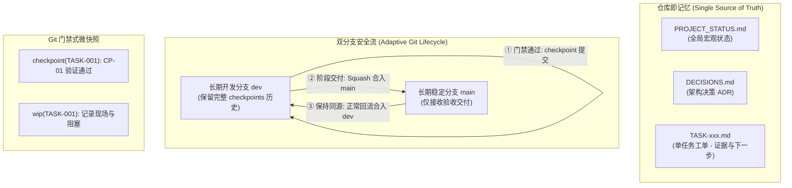

# 🔄 Agent Handoff Workflow (AI 项目连续性与 Git 原生交接工作流)

[](SKILL.md)
[](../../LICENSE)
[](scripts/tests/)
[](#适用平台与生态)

> **让 AI 告别会话失忆，让多次会话、多位 Agent、跨设备协同如丝般顺滑接力。**  
> 基于 **“项目文件作为唯一记忆载体 (In-Repo Context & Single Source of Truth)”** 哲学，融合 Git 原生版本流、门禁式微快照与 Token 预算保护。

---

## 📖 目录

- [一、痛点与设计背景](#一痛点与设计背景)
- [二、核心设计哲学与机制](#二核心设计哲学与机制)
  - [1. 记忆载体：代码仓库是唯一真相](#1-记忆载体代码仓库是唯一真相)
  - [2. 双长期分支模型：dev 与 main](#2-双长期分支模型dev-与-main)
  - [3. 门禁式 Git 微快照：以 Git 历史为账本](#3-门禁式-git-微快照以-git-历史为账本)
  - [4. 物理证据链核验：杜绝伪完成](#4-物理证据链核验杜绝伪完成)
  - [5. Token 上下文预算保护：单工单精准加载](#5-token-上下文预算保护单工单精准加载)
  - [6. 双闸门受控交付：严格安全控制](#6-双闸门受控交付严格安全控制)
- [三、目录与文件结构](#三目录与文件结构)
- [四、安装与配置指南](#四安装与配置指南)
- [五、日常实操场景与自然语言指令](#五日常实操场景与自然语言指令)
- [六、内置接手检查工具 (CLI)](#六内置接手检查工具-cli)
- [七、自动化测试套件](#七自动化测试套件)
- [八、版本演进与变更记录](#八版本演进与变更记录)

---

## 一、痛点与设计背景

在与现代大模型 AI 编码助手（如 Google Antigravity、Claude Code、Cursor、OpenAI Codex 等）结对开发复杂工程时，开发者经常遇到以下痛点：

1. **上下文清空后失忆**：会话关闭、重启或切换窗口后，AI 不清楚上一次开发做到了哪一步，往往推倒重来或凭空猜测；
2. **多设备协作脱节**：一台电脑改完未规范同步，另一台电脑拉取代码后缺失中间脉络，导致脏提交与代码覆盖；
3. **散乱与账本膨胀**：工单中手工维护几百条 Commit 哈希，不仅迅速挤爆 AI 的上下文窗口，且与真实代码脱节；
4. **口头完成与假性绿灯**：AI 汇报“已全部通过”，但物理代码中缺失关键实现或测试根本未运行；
5. **非受控破坏**：未经授权私自执行 `git push`、破坏性 `git reset --hard`、或直接在生产分支乱写乱改。

**`agent-handoff-workflow`** 正是为彻底解决上述问题而设计的一整套工业级 AI 协作规范与工具链。

---

## 二、核心设计哲学与机制



### 1. 记忆载体：代码仓库是唯一真相
- 严禁将关键状态写在 IDE 私有“脑库”中。
- 所有设计方案落盘到 `docs/designs/`，决策落盘到 `docs/DECISIONS.md`，宏观进展落盘到 `docs/PROJECT_STATUS.md`。

### 2. 双长期分支模型：dev 与 main
- **`dev` (开发分支)**：日常开发、实验探索与高频阶段快照（`checkpoint`）均在此分支进行，完整保留历史轨迹；
- **`main` (稳定分支)**：只接收完成且经过端到端验收的交付成果，日常严禁直接在此分支写代码；
- **标准交付流**：验收一批完整 dev 改动 → Squash 到 main → 将新 main 正常合并回 dev（保留共同祖先，杜绝 reset 对齐）。

### 3. 门禁式 Git 微快照：以 Git 历史为账本
- **`checkpoint(TASK-xxx): CP-01 [描述]`**：代码必须通过必要测试门禁，Git 哈希是唯一定位标识；
- **`wip(TASK-xxx): [描述]`**：授权保存未完成现场，明确指出失败与缺口，不与稳定 checkpoint 混称；
- **工单免维护旧账本**：工单只需记录关键里程碑和下一步，所有快照直接通过 `git log` 快速反查。

### 4. 物理证据链核验：杜绝伪完成
- 接手任何工单时，**严禁盲目信任工单上的勾选项**；
- 必须核验对应的物理文件路径、符号函数是否存在，并运行测试验证结果。

### 5. Token 上下文预算保护：单工单精准加载
- 接手任务时，精准定位并仅加载当前指派的单一 `docs/tasks/TASK-xxx.md`；
- 严禁无脑阅读任务目录下的所有历史文档，保护大模型的注意力焦点与上下文窗口。

### 6. 双闸门受控交付：严格安全控制
- **闸门一（主干合并审批）**：全部验收且测试全绿后，汇报交付摘要，经用户明确同意方可执行合并；
- **闸门二（远程发布授权）**：向用户申请远程推送，经用户明确同意方可执行 `git push origin main`。

---

## 三、目录与文件结构

```text
agent-handoff-workflow/
├── README.md                   # 本说明文档
├── SKILL.md                    # AI 读取的标准 Skill 元数据与核心操作准则
├── assets/
│   └── templates/              # 初始化项目时才需要的标准化模板
│       ├── AGENTS.md           # 顶级项目规范模板（注入 AI 行为约束）
│       ├── PROJECT_STATUS.md   # 宏观项目状态、Roadmap 与工单索引模板
│       ├── DECISIONS.md        # 架构决策记录 (ADR) 模板
│       └── TASK-TEMPLATE.md    # 标准单任务工单模板
├── references/                 # 深度参考手册（按需查阅，不占全局上下文）
│   ├── continuity.md           # 初始化检查、任务定位与异常接续细则
│   └── git-lifecycle.md        # Git 完整操作细则、快照规范与中断恢复表
└── scripts/                    # 辅助脚本与测试套件
    ├── inspect_handoff.py      # 只读接手检查工具 (Python 3.9+, 零三方依赖)
    └── tests/
        └── test_inspect_handoff.py  # 11 个场景的完整回归单测套件
```

---

## 四、安装与配置指南

### 1. 全局安装到 Google Antigravity
将本技能目录复制或符号链接到用户全局 Skills 路径下：

```powershell
# Windows PowerShell
$target = "$HOME\.gemini\config\skills\agent-handoff-workflow"
Copy-Item -Path "skills\agent-handoff-workflow" -Destination $target -Recurse -Force
```

### 2. 工作区（单个项目）安装
在目标项目的工作区中引入：

```bash
# 复制到项目的 .gemini/skills 目录下
mkdir -p .gemini/skills
cp -r /path/to/Personal-SKILL/skills/agent-handoff-workflow .gemini/skills/
```

### 3. 适用平台与生态
- **Google Antigravity**：直接识别 `SKILL.md`，支持斜杠命令调用 `/agent-handoff-workflow`；
- **Claude Code**：可在项目的 `CLAUDE.md` 或 rules 中引用本规范；
- **Cursor / Codex**：将 `assets/templates/AGENTS.md` 内容复制到 `.cursorrules` 或项目根目录 `AGENTS.md` 中。

---

## 五、日常实操场景与自然语言指令

AI 助手加载本 Skill 后，能敏锐感知并响应以下场景：

| 用户自然语言指令 | AI 规范执行动作 | 参考文档 |
| --- | --- | --- |
| **“给项目建立接手规范”** | 检查项目现状，从模板补齐 `AGENTS.md`、`docs/PROJECT_STATUS.md`、`DECISIONS.md`，不覆盖已有内容 | [continuity.md](references/continuity.md) |
| **“接手这个任务 / 接手 TASK-002”** | 读取全局状态与单工单，核对当前分支与物理代码，运行基础测试校验，接着“下一步”开始编码 | [continuity.md](references/continuity.md) |
| **“保存当前进度”** | 检查变更与授权，门禁通过后打出 `checkpoint(...)` 本地提交，未完成则生成 `wip(...)` 现场 | [git-lifecycle.md](references/git-lifecycle.md) |
| **“换设备继续”** | 核对开发分支是否已同步至远程、新设备是否拉取一致提交、核验是否有未跟踪的本机私有资产 | [git-lifecycle.md](references/git-lifecycle.md) |
| **“功能完成，合并到主分支”** | 运行全量回归测试，通过后向用户申请审批，Squash 到 `main` 并反向合并回 `dev` | [git-lifecycle.md](references/git-lifecycle.md) |
| **“回到某个快照 / 回退到 CP-01”** | 从 Git 历史中精准匹配实际 Commit 哈希，安全保护当前改动后执行检出或回滚 | [git-lifecycle.md](references/git-lifecycle.md) |
| **“解释接手流程”** | 仅做概念与流程分析，严格禁止自动初始化项目或创建工单 | [SKILL.md](SKILL.md) |

---

## 六、内置接手检查工具 (CLI)

Skill 内置了只读检查工具 [`scripts/inspect_handoff.py`](scripts/inspect_handoff.py)。它是一个纯标准库脚本，仅汇总事实，**严格不执行任何写操作、提交、清理或静默修复**。

### 常用命令示例：

```bash
# 1. 本地状态快速汇总（分支、工作区脏状态、最近快照）
python scripts/inspect_handoff.py --repo "." --dev dev --stable main

# 2. 检查远程同步状态（安全只读 ls-remote，不 fetch、不改追踪引用）
python scripts/inspect_handoff.py --repo "." --check-remote

# 3. 输出标准化 JSON（供自动化脚本或 Agent 解析判断）
python scripts/inspect_handoff.py --repo "." --check-remote --json

# 4. 精准核验某个预期 Commit 哈希与任务 ID
python scripts/inspect_handoff.py --repo "." --expect 4a8b1c2d3e --task TASK-007
```

### JSON 返回关键字段说明：
- `handoff.state`:
  - `git_history_verified`：本地开发提交与远端一致；
  - `unverified`：尚未联网校验或有未同步改动；
  - `blocked`：存在冲突、断档或未授权分支状态。

---

## 七、自动化测试套件

本项目内置了高覆盖率的自动化回归测试套件 [`scripts/tests/test_inspect_handoff.py`](scripts/tests/test_inspect_handoff.py)，涵盖了 11 种复杂的真实 Git 协作场景：

1. 未初始化/空仓库防御校验 (`test_unborn_repository`)
2. 快照筛选与指定历史校验 (`test_checkpoint_filter_and_expected_history`)
3. 自定义远程分支映射 (`test_custom_remote_branch_mapping`)
4. 双设备分叉检测与报警 (`test_diverged_devices`)
5. 中断交付安全恢复无重复提交 (`test_interrupted_delivery_resume_without_duplicate`)
6. 本地离线与网络探测边界 (`test_live_observation_and_cached_only`)
7. 主分支反向合并冲突保护 (`test_main_backflow_conflict_preserved`)
8. 离线时不误报远程一致 (`test_offline_remote_not_reported_equal`)
9. 双分支独立推送边界隔离 (`test_partial_push_separate_branches`)
10. 远端变更但未 fetch 时的感知 (`test_remote_changed_without_fetch`)
11. 暂存区改名、二进制资产与忽略文件保留 (`test_staged_user_rename_binary_and_ignored_preserved`)

### 运行测试：
```bash
python -B scripts/tests/test_inspect_handoff.py
```
> 输出 `Ran 11 tests ... OK` 即代表工具与环境 100% 正常。

---

## 八、版本演进与变更记录

- **v2.2.0 (当前版本)**：
  - 确立 `dev` / `main` 双长期分支与 Squash 推广回流规范；
  - 废弃在工单内维护冗长手工 Commit 账本，全面转向 Git 原生日志索引；
  - 强化只读接手工具的隔离单测，支持 11 项全自动边界测试；
  - 增加 Token 上下文预算保护与单工单加载协议。
- **v2.1.0**：
  - 引入 `inspect_handoff.py` 只读检查工具与 JSON 契约。
- **v2.0.0**：
  - 制定四级文档模版（`AGENTS`、`PROJECT_STATUS`、`DECISIONS`、`TASK`）。

---

## 📄 开源许可证

本项目基于 [MIT 许可证](../../LICENSE) 开源。
